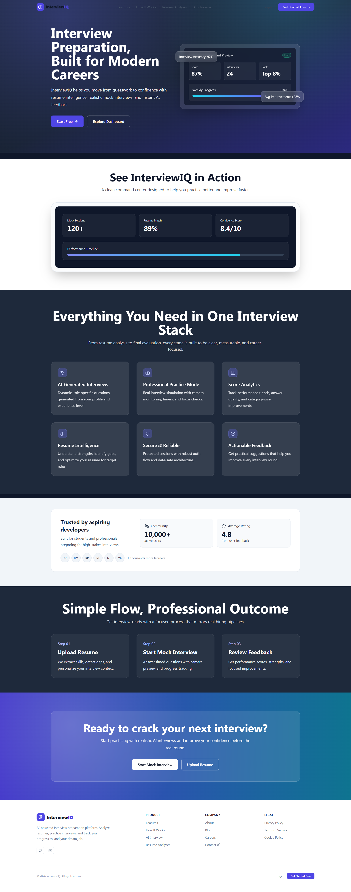
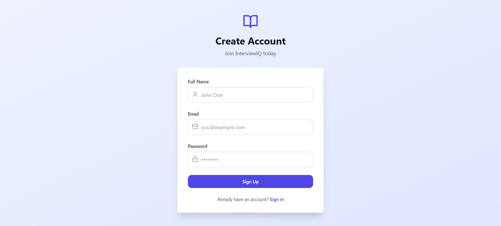
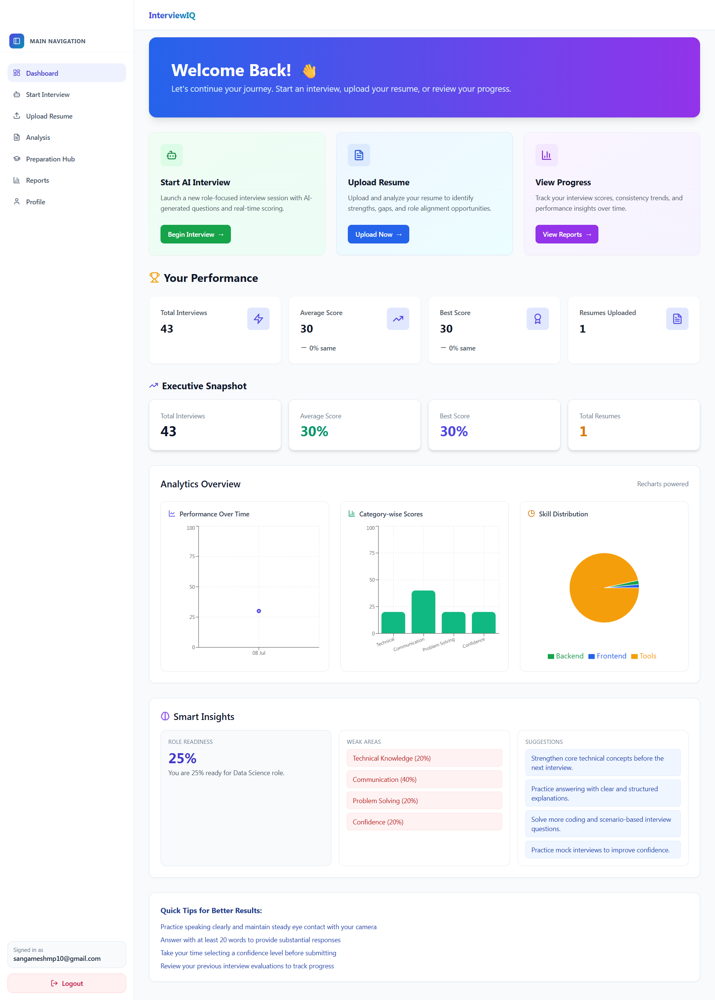
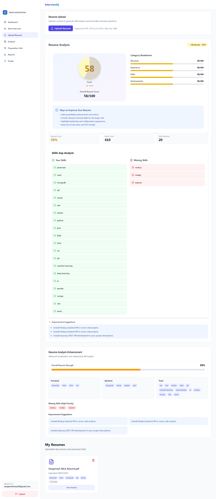
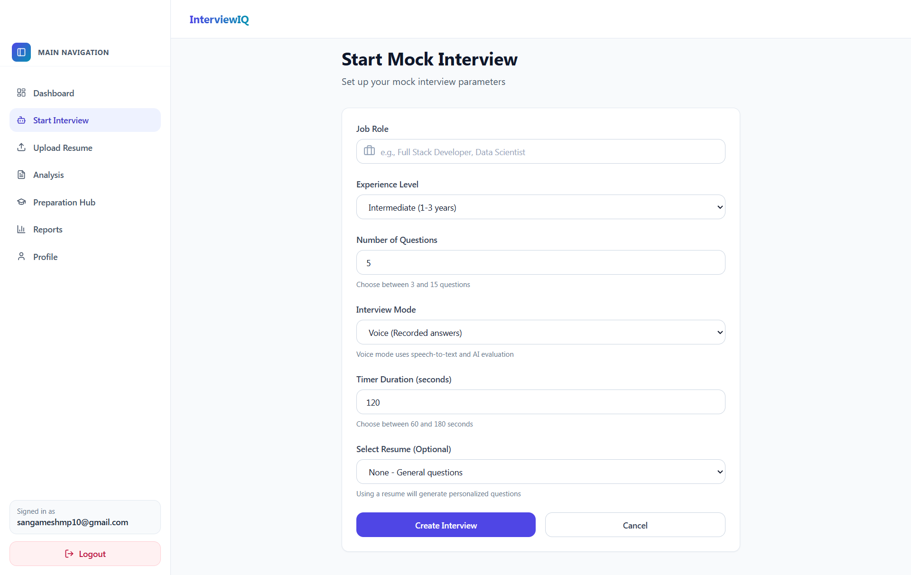
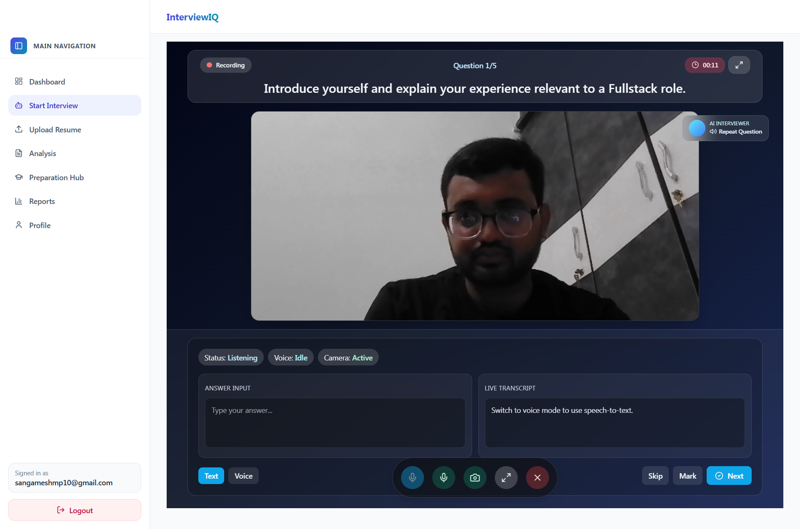
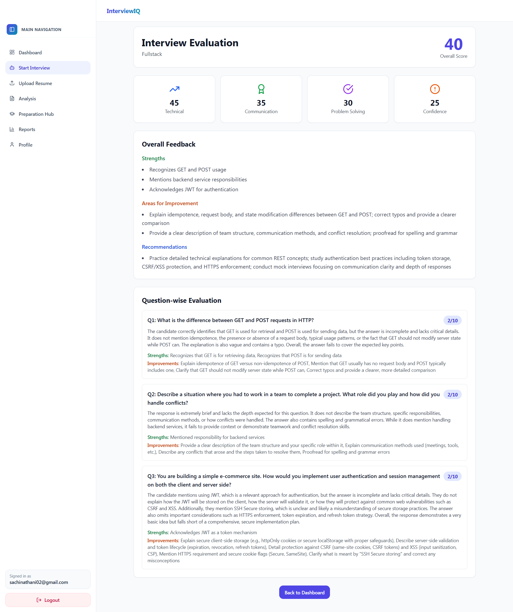
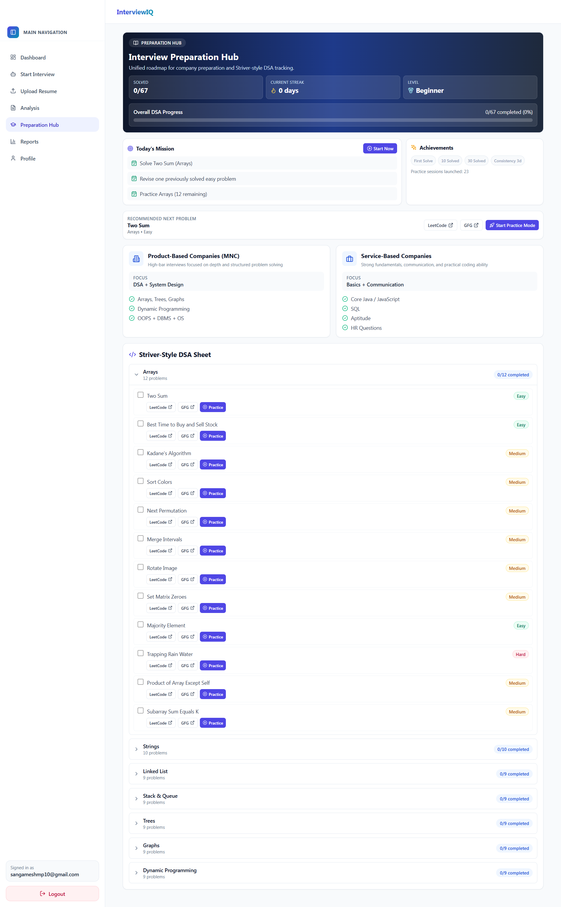
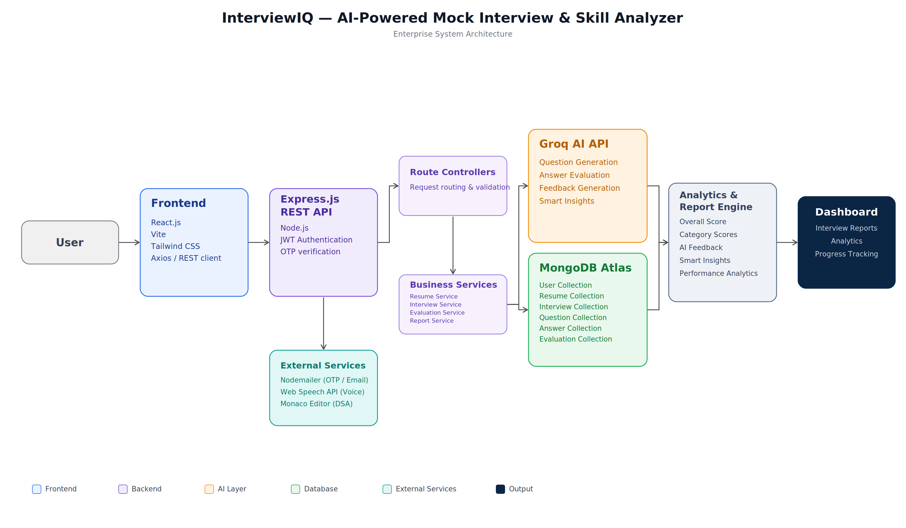

# InterviewIQ – AI-Powered Mock Interview & Skill Analyzer

[](https://nodejs.org/)
[](https://react.dev/)
[](https://vitejs.dev/)
[](https://expressjs.com/)
[](https://www.mongodb.com/atlas)
[](https://groq.com/)

## Professional Tagline

An AI-powered interview preparation platform that combines resume analysis, personalized mock interviews, answer evaluation, and progress tracking into a unified learning experience.

## Table of Contents

- [About the Project](#about-the-project)
- [Key Highlights](#key-highlights)
- [Application Screenshots](#application-screenshots)
- [System Architecture](#system-architecture)
- [Technology Stack](#technology-stack)
- [Features](#features)
- [Quick Start](#quick-start)
- [Folder Structure](#folder-structure)
- [Documentation](#documentation)
- [Future Enhancements](#future-enhancements)
- [Author](#author)
- [License](#license)
- [Acknowledgements](#acknowledgements)

## About the Project

InterviewIQ is an AI-powered mock interview and skill analysis platform developed as an MCA Final Year Project. It provides a unified environment where candidates can upload their resumes, assess their skills, practice technical interviews, receive AI-assisted feedback, and monitor their interview readiness through a structured workflow.

### Why InterviewIQ?

Interview preparation is often fragmented across multiple platforms for resume analysis, coding practice, mock interviews, and performance tracking. This makes it difficult for candidates to prepare efficiently and measure their overall progress.

### Problem Statement

Many candidates lack a single platform that can transform their resume into a personalized interview preparation experience while providing structured evaluation, progress tracking, and actionable feedback.

### Project Objective

InterviewIQ aims to streamline interview preparation by integrating resume upload, local resume analysis, AI-powered interview generation, answer evaluation, performance reporting, and progress tracking into one comprehensive platform.

### Target Users

- MCA and Engineering students
- Final-year placement candidates
- Fresh graduates
- Software developer job seekers
- Self-learners preparing for technical interviews

## Key Highlights

| Highlight | Description |
|---|---|
| AI Interview Engine | Generates interview questions and evaluates answers through the Groq-backed AI service layer. |
| Resume Skill Analysis | Extracts resume text from PDF or DOCX files and scores it using local skill matching logic. |
| Interview Workflow | Supports interview creation, live answering, completion, and session tracking. |
| Smart Reports | Provides progress, trends, category scores, skills, insights, and heatmap views. |
| Secure Access | Uses OTP verification, JWT access tokens, refresh tokens, and protected routes. |

## Application Screenshots

| | |
|---|---|
| **Landing Page**<br>Public entry point with the product story and navigation.<br><br> | **Sign Up**<br>Registration flow with OTP-based account creation.<br><br> |
| **Dashboard**<br>Authenticated overview of interviews, resumes, and progress.<br><br> | **Resume Analysis**<br>Local resume scoring and skill-gap summary.<br><br> |
| **Create Interview**<br>Interview setup based on role, level, and resume context.<br><br> | **Live Interview**<br>Interactive interview session for text or voice answers.<br><br> |
| **Evaluation Report**<br>Interview result view with scores and feedback.<br><br> | **DSA Preparation Hub**<br>Preparation area for practice and revision.<br><br> |

## System Architecture



InterviewIQ follows a layered MERN architecture.

- The client layer handles the user interface in the browser.
- The frontend layer uses React, Vite, Tailwind CSS, React Router, and Axios for routing, UI rendering, and API calls.
- The backend layer exposes REST APIs through Node.js and Express.js, handles JWT authentication, OTP flows, validation, uploads, and business rules.
- The AI layer uses the Groq-compatible chat wrapper for interview question generation, answer evaluation, and feedback generation.
- MongoDB Atlas stores users, resumes, interviews, evaluations, questions, answers, session data, and analysis records.
- Cloudinary stores uploaded resume files and interview media.
- Nodemailer handles email delivery for OTP and password reset flows.

## Technology Stack

| Layer | Technologies | Purpose |
|---|---|---|
| Frontend | React 18, Vite, React Router DOM, Axios, Tailwind CSS, React Hot Toast, Zustand, Recharts, Lucide React, @monaco-editor/react | UI rendering, client routing, API communication, state management, charts, notifications, and code editor support |
| Backend | Node.js, Express.js, MongoDB, Mongoose, JWT, bcryptjs, cookie-parser, cors, dotenv, express-rate-limit, joi, multer, nodemailer | API server, authentication, validation, file uploads, email delivery, and persistence |
| AI Layer | Groq API, OpenAI Node client | Interview question generation, answer evaluation, AI feedback, and smart insights through the Groq-compatible API |
| Resume Processing | pdf-parse, mammoth | Resume text extraction from PDF and DOCX files |
| Storage & Media | Cloudinary, MongoDB Atlas | Resume file storage and application data persistence |
| Dev Tooling | concurrently, nodemon | Local development and parallel frontend/backend execution |

## Features

### Authentication

- User registration with email and password.
- OTP verification and resend flow.
- Login with JWT access and refresh tokens.
- Forgot password and reset password flow using OTP.
- Protected routes and admin-only access for user listing.

### Resume Analysis

- Resume upload through protected endpoints.
- PDF and DOCX text extraction.
- Local skill matching against a verified skill dictionary.
- ATS-style scoring based on skill coverage, skill count, and word count.
- Resume analysis records stored in MongoDB.

### Interview Engine

- Interview creation with job role, experience level, question count, mode, timer, and optional resume reference.
- Interview start, completion, activity logging, and deletion.
- Text answer submission and voice answer upload.
- Interview generation from resume context.
- Recording upload for interview sessions.

### AI Evaluation

- Groq-backed interview question generation.
- Groq-backed answer evaluation.
- Groq-backed overall feedback generation.
- Fallback behavior when AI responses are missing or invalid.

### Dashboard

- Total interviews.
- Total resumes.
- Average score.
- Best score.
- Average ATS score.

### DSA Hub

- Dedicated preparation hub page in the frontend.
- Code editor support through Monaco Editor.

## Quick Start

### Clone

```bash
git clone <repository-url>
cd "Mern Stack"
```

### Install

```bash
npm install

cd backend
npm install

cd ..\frontend
npm install
```

### Run Backend

```bash
cd backend
npm run dev
```

### Run Frontend

```bash
cd frontend
npm run dev
```

## Folder Structure

| Path | Purpose |
|---|---|
| `assets/screenshots/` | Verified screenshots and architecture image used in the README. |
| `backend/` | Node.js and Express backend, API routes, services, models, validation, and middleware. |
| `frontend/` | React and Vite frontend with pages, components, state, and client services. |
| `docs/` | Detailed documentation for APIs, architecture, database design, and deployment. |

## Documentation

- API Documentation -> [docs/API.md](docs/API.md)
- System Architecture -> [docs/ARCHITECTURE.md](docs/ARCHITECTURE.md)
- Database Design -> [docs/DATABASE.md](docs/DATABASE.md)
- Deployment Guide -> [docs/DEPLOYMENT.md](docs/DEPLOYMENT.md)

## Future Enhancements

- Add downloadable PDF reports for interview results.
- Add richer analytics filters for report pages.
- Expand the DSA preparation hub with curated topic-wise practice content.
- Add optional file previews and upload progress indicators for resumes and recordings.
- Add deployment-specific config samples for production environments.

## Author

Prepared by Sangamesh — MCA Final Year Project (Nitte Meenakshi Institute of Technology, Bengaluru).

## License

This project is an academic submission developed as part of the Master of Computer Applications (MCA) program at Nitte Meenakshi Institute of Technology. It is not licensed for external reuse or commercial distribution.

## Acknowledgements

Thanks to the open-source ecosystem behind React, Vite, Express, MongoDB, Groq-compatible AI tooling, Cloudinary, Nodemailer, and the supporting frontend and backend libraries used in this project.
