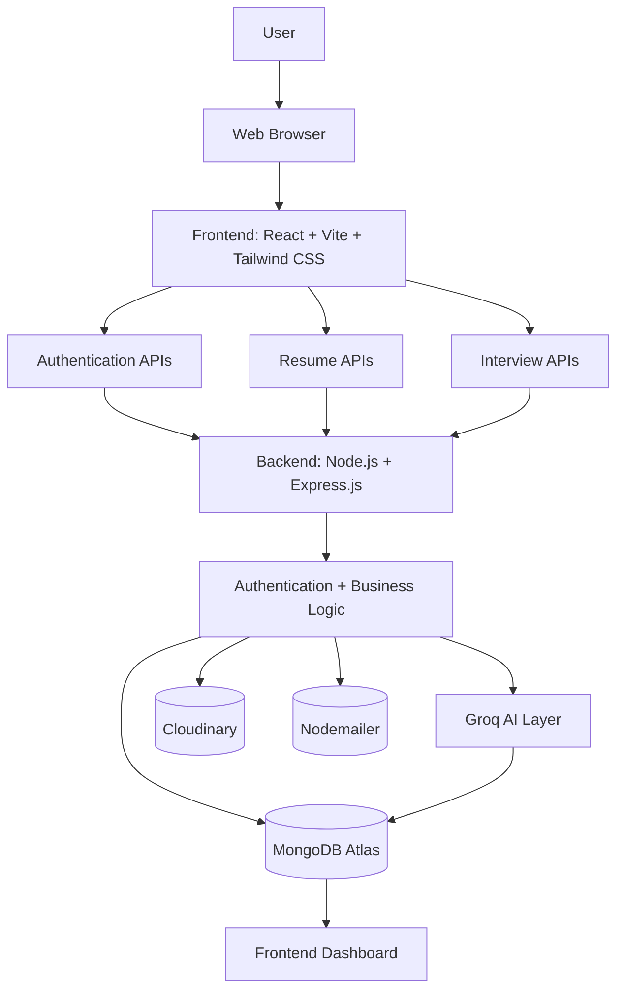
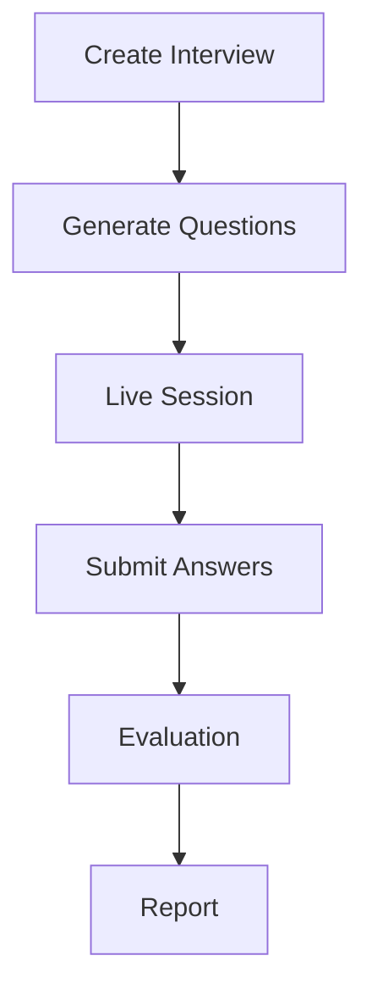
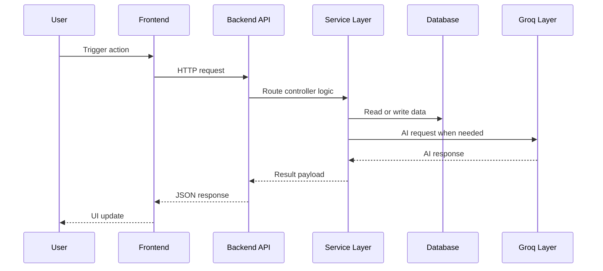

# System Architecture

This document explains the architecture of InterviewIQ and how the major application layers interact.

## System Architecture

InterviewIQ follows a layered MERN architecture.

- The client layer handles the user interface in the browser.
- The frontend layer uses React, Vite, Tailwind CSS, React Router, and Axios for routing, UI rendering, and API calls.
- The backend layer exposes REST APIs through Node.js and Express.js, handles JWT authentication, OTP flows, validation, uploads, and business rules.
- The AI layer uses the Groq-compatible chat wrapper for interview question generation, answer evaluation, and feedback generation.
- MongoDB Atlas stores users, resumes, interviews, evaluations, questions, answers, session data, and analysis records.
- Cloudinary stores uploaded resume files and interview media.
- Nodemailer handles email delivery for OTP and password reset flows.

## Component Flow

## Frontend Architecture

The frontend uses route-level pages, reusable components, a shared authentication context, and client-side services for API calls.

The repository also uses lazy-loaded React routes and a Zustand store for application state.

## Backend Architecture

The backend is organized into configuration, controllers, routes, services, models, middleware, validators, and utilities.

The main service layer handles auth, resume analysis, interview management, evaluation, reporting, speech, and AI integration.

## Groq AI Integration

The AI layer is built around the Groq-compatible chat wrapper in `backend/src/services/groqChat.js` and the interview AI service in `backend/src/services/ai.service.js`.

- Interview question generation uses Groq through `generateInterviewQuestions()`.
- Answer evaluation uses Groq through `evaluateAnswer()`.
- Overall interview feedback uses Groq through `generateOverallFeedback()`.
- The legacy `backend/services/aiService.js` supports `/api/ai/generate` and `/api/ai/analyze-resume` with the same Groq-backed wrapper.

> [!IMPORTANT]
> Groq is used for interview and AI utility flows. Resume upload analysis is local and does not call Groq in the current implementation.

## Resume Analysis Flow

Resume analysis is performed locally through text extraction and keyword scoring.

## Interview Flow

## Evaluation Flow

Evaluation combines interview answers, interview context, and AI-backed feedback when available.

The report views aggregate scores, category breakdowns, trends, and insights from stored evaluation data.

## Request Lifecycle

