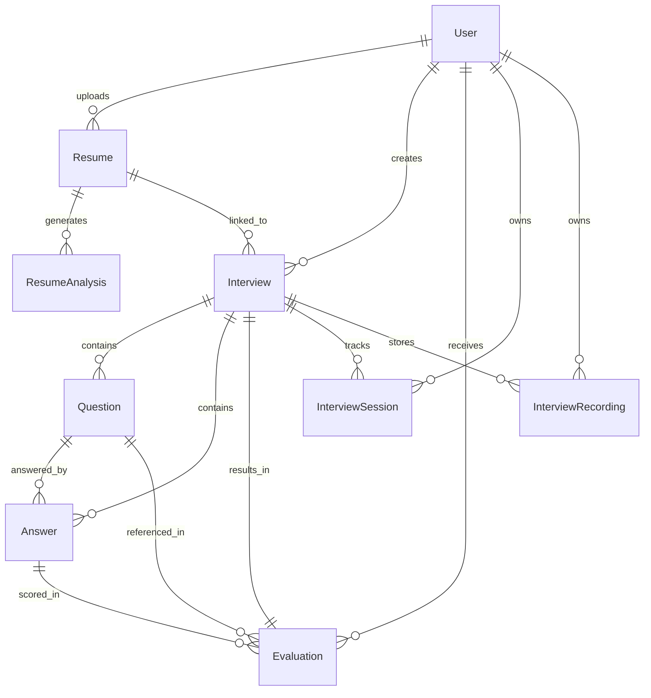

# Database Design

This document summarizes the database layer used by InterviewIQ.

## Database Overview

InterviewIQ uses MongoDB with Mongoose models for users, resumes, interviews, evaluations, session tracking, answers, questions, recordings, and resume analysis records.

The codebase also stores a cached analysis record for each uploaded resume through the ResumeAnalysis model.

## Collections

| Collection | Purpose |
|---|---|
| User | Stores account details, verification state, role, and account status. |
| Resume | Stores uploaded resume metadata, extracted text, and scoring information. |
| ResumeAnalysis | Stores the cached analysis result for a resume upload. |
| Interview | Stores interview configuration, status, and resume linkage. |
| Question | Stores generated interview questions and metadata. |
| Answer | Stores user answers for interview questions. |
| Evaluation | Stores interview evaluation results and question-level references. |
| InterviewSession | Stores live interview session state and question queue data. |
| InterviewRecording | Stores interview recording metadata. |

## Relationships

## ER Diagram

The ER diagram above reflects the repository’s documented relationships between users, resumes, interviews, questions, answers, evaluations, sessions, and recordings.

## Model Explanation

| Model | Notes |
|---|---|
| User | Stores name, email, role, verification state, and account status. |
| Resume | Stores filename, fileUrl, cloudinaryPublicId, extractedText, skillScore, and resumeStrength. |
| ResumeAnalysis | Stores the analysis score, wordCount, and references to user and resume. |
| Interview | Stores jobRole, experienceLevel, status, numberOfQuestions, mode, and user/resume references. |
| Question | Stores questionText, questionNumber, category, difficulty, and interview reference. |
| Answer | Stores answerText, mode, status, timeTaken, and interview/question references. |
| Evaluation | Stores overallScore and interview/user references, with question-level references in questionEvaluations. |
| InterviewSession | Stores questionQueue, currentQuestionIndex, and status. |
| InterviewRecording | Stores mediaUrl, mimeType, and size. |

## Indexes

The repository documents indexes on resumes, interviews, evaluations, questions, answers, sessions, and recordings.

These indexes support lookup, reporting, and interview workflow queries across the application.